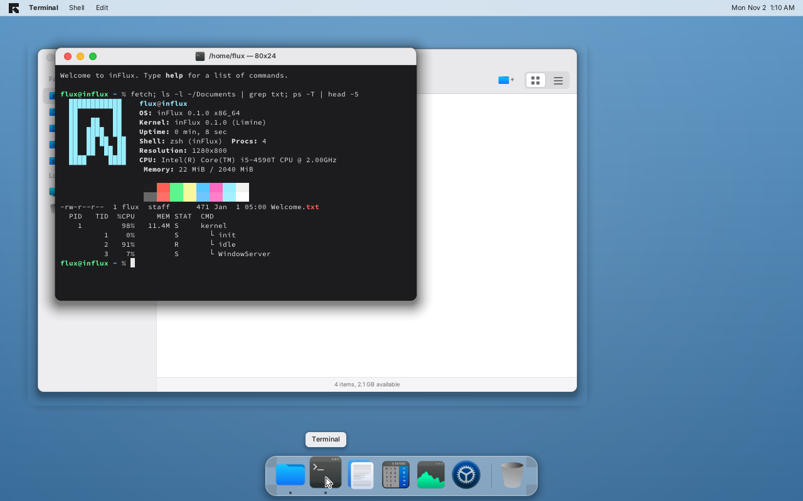
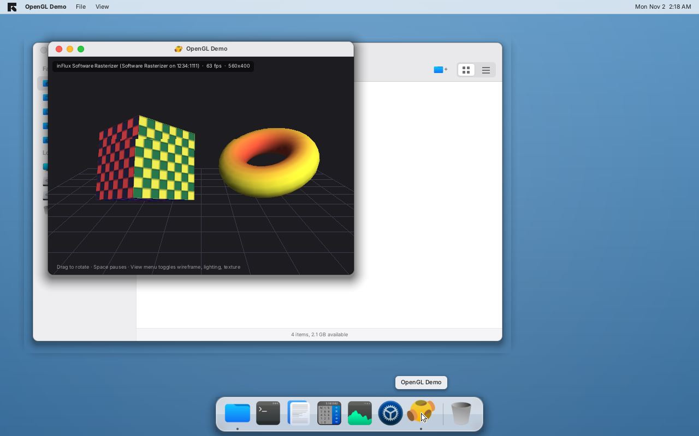

# inFlux

inFlux is a small x86-64, Unix-like operating system with a preemptive,
multithreaded kernel and a macOS-style desktop. It boots with the Limine
bootloader, drives SATA (AHCI) and NVMe disks, and reads and writes btrfs
volumes with its own filesystem driver.

**This entire operating system was written by Claude**, Anthropic's AI model,
in a single session: kernel, drivers, filesystems, window server, applications,
shell, user-space C library and build system.



## Features

### Kernel
- 64-bit kernel loaded by Limine (BIOS and UEFI), higher-half mapping
- GDT/TSS, full IDT with exception reporting, I/O APIC + local APIC timer
- Physical memory manager (bitmap), 4-level paging with per-process address
  spaces, bucket heap allocator
- Preemptive round-robin scheduler with kernel threads and ring-3 user
  threads, sleep queues, wait queues, mutexes, semaphores, FPU state switching
- Processes with file descriptor tables, working directories, exit status and
  `wait`; kernel-side killing of faulting user programs
- `syscall`/`sysret` fast system calls (31 calls: files, directories, process
  spawning, pipes, sleep, uname, sysinfo, process listing, block devices)
- Static ELF64 loader for user programs

### Storage and filesystems
- PCI enumeration
- AHCI (SATA) driver with LBA48 DMA reads and writes
- NVMe driver (admin + I/O queue pair, PRP lists)
- Block device layer with GPT and MBR partition scanning (`/dev/sda1`,
  `/dev/nvme0n1p1`, ...)
- Virtual filesystem with a tmpfs root populated from a tar initrd, device
  nodes, pipes and ttys
- **btrfs read/write**: chunk mapping, B-tree search and modification with
  leaf/node splits, inline and regular extents, directory items and indexes,
  CRC32C checksums for metadata and data, extent-tree and free-space-tree
  bookkeeping. Volumes modified by inFlux pass `btrfs check` on Linux.

### Graphics
- **ATI Radeon R700 driver** (HD 4800/4700/4600/4300/4500 and the RS880 IGP),
  modelled on the Linux `radeon` driver: PCI probe, register and VRAM
  aperture mapping, VRAM size and MC framebuffer location, inspection of the
  scanout that the video BIOS (BIOS boot) or GOP (UEFI boot) configured,
  AtomBIOS ROM parsing (bootup message, part number, default clocks), a 64x64
  ARGB hardware cursor and vblank-synchronised double-buffered page flipping
  of the primary surface. Every other adapter uses the **software fallback**
  (CPU compositing into the bootloader's linear framebuffer).
- **OpenGL**: a fixed-function OpenGL 1.x subset (immediate mode, matrix
  stacks, depth test, Gouraud lighting, textures with bilinear filtering,
  blending, culling, wireframe) with a software rasteriser. The same
  implementation (`gl/gl.c`) is built into the kernel for desktop apps and
  into the user C library; `glGetString(GL_RENDERER)` names the adapter the
  frame ends up on. The desktop has an **OpenGL Demo** app and `/bin/glcube`
  renders from user space into a desktop window (`win_create`,
  `win_present`, `win_event` system calls).
- BIOS and UEFI boot both work through Limine's hybrid ISO; under BIOS the
  Radeon's VBIOS sets the mode through VBE and the driver takes over scanout
  programming from there.



### Desktop
- Software-composited window server with damage tracking, drop shadows,
  rounded windows, traffic-light controls, drag/resize/zoom/minimize
- macOS-like menu bar: system menu (About, Settings, Task Manager, Restart,
  Shut Down), per-application menus with keyboard shortcuts, date and time
- Dock with pinned apps, running indicators, hover tooltips and Trash
- Light and dark appearance, eight accent colors, wallpaper presets
  (default: steel blue)
- Applications: **Files** (sidebar, icon/list views, history, new folder,
  rename, duplicate, move to Trash, Get Info), **Terminal**, **Text Editor**
  (selection, clipboard, undo, open/save), **Calculator**, **Task Manager**
  (live CPU/memory/threads, force quit), **System Settings**
- zsh-like shell: line editing, history (persisted to `~/.zsh_history`), Tab
  completion, aliases, environment variables, globbing, pipes, redirection,
  `&&`/`||`, background jobs, 60+ built-ins, and external programs from `/bin`
- User programs: `hello`, `cat`, `ls`, `echo`, `primes`, `sleep`, `sysinfo`,
  `crash`

Icons come from the [Kora icon theme](https://github.com/bikass/kora), the UI
uses [Inter](https://fonts.google.com/specimen/Inter) and the terminal uses
[Source Code Pro](https://fonts.google.com/specimen/Source+Code+Pro).

## Building

Requirements (Debian/Ubuntu package names):

- `gcc`, `make`, `binutils`
- `xorriso` (ISO creation)
- `qemu-system-x86` (to run it)
- `btrfs-progs` and `util-linux` (`mkfs.btrfs`, `sfdisk`) to create the test disks

```sh
make            # builds build/influx.iso
make disk       # creates build/sata.img and build/nvme.img (btrfs test volumes)
make run        # boots in QEMU with a SATA and an NVMe disk attached
make run-kvm    # same, with KVM acceleration
```

The build compiles the kernel with the host GCC in freestanding mode, rasterises
the fonts and icons with the small host tools in `tools/`, packs `build/sysroot`
into a ustar initrd and produces a hybrid BIOS/UEFI ISO with Limine.

Changing the SVG icon sources requires `python3` with `cairosvg`; run
`tools/render_icons.py` to regenerate the committed PNGs.

## Using it

- Click an icon in the Dock to start an application; double-click files in
  Files to open them.
- Keyboard shortcuts: `⌘Q` quit, `⌘W` close window, `⌘M` minimize, `⌘Tab` cycle
  windows, `⌘,` System Settings, `Ctrl+Alt+Delete` Task Manager. On a PC keyboard
  the Windows key is `⌘`; `Ctrl` works as an alias outside the Terminal.
- The btrfs volumes appear in the Files sidebar and under `/mnt`. Try
  `echo hi > /mnt/sda1/hello.txt` in the Terminal, then inspect `build/sata.img`
  on Linux (the filesystem starts 1 MiB into the image).
- Type `help` in the Terminal for the list of shell built-ins; programs in
  `/bin` run in user mode. `lsgpu` shows the graphics adapter, `glcube &`
  starts the user-mode OpenGL program.

## Layout

```
kernel/src/arch     GDT, IDT, APIC, ACPI, PCI, timers, serial
kernel/src/mm       physical/virtual memory, heap
kernel/src/sched    scheduler, synchronisation, ELF loader, system calls
kernel/src/drivers  framebuffer, PS/2, AHCI, NVMe, block devices, GPU abstraction, Radeon R700
kernel/src/gl       kernel build of the OpenGL renderer and the OpenGL Demo app
gl                  shared software OpenGL implementation (gl.c / gl.h)
kernel/src/fs       VFS, tmpfs, initrd, tty, pipes, btrfs
kernel/src/gfx      canvas primitives, fonts, images
kernel/src/ui       window server, theme, widgets, dialogs, app registry
kernel/src/apps     Files, Terminal, shell, Editor, Calculator, Task Manager, Settings
user/libc           minimal C library for user programs
user/bin            user-mode programs
tools               fontgen, imgconv, icon renderer, test-disk builder
assets              fonts, icons, logo
third_party         Limine, stb headers
```

## Limitations

- Single CPU (other cores are left parked), no networking, no audio, no USB.
- btrfs: single-device volumes with CRC32C checksums only; no compression,
  snapshots, RAID or zoned support. Metadata is updated in place rather than
  copy-on-write, so an interrupted write can leave the volume inconsistent;
  the free space tree is kept consistent, or marked for rebuild if a block
  group uses the bitmap format.
- The desktop applications run as kernel threads; only `/bin` programs run in
  ring 3.
- The Radeon driver was written from the Linux radeon register definitions
  and has not been run on real HD 4000 hardware yet; it never touches the 3D
  engine (that needs the R700 CP microcode and a command-stream backend), so
  OpenGL is always software-rendered. QEMU does not emulate an R700, so the
  software path is what you see under QEMU.
- The hardware clock is assumed to be in UTC; adjust the offset in
  System Settings → Date & Time.

## Licenses

inFlux's own code is released under the MIT license. Third-party components keep
their licenses: Limine (BSD-2-Clause), stb (public domain/MIT), Inter and
Source Code Pro (SIL Open Font License), Kora icons (GPL-3.0).
